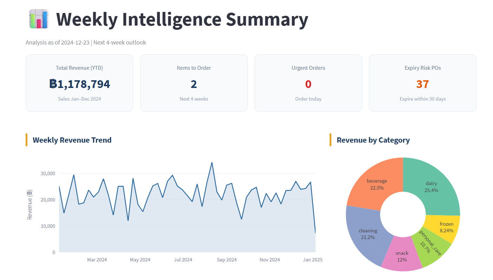
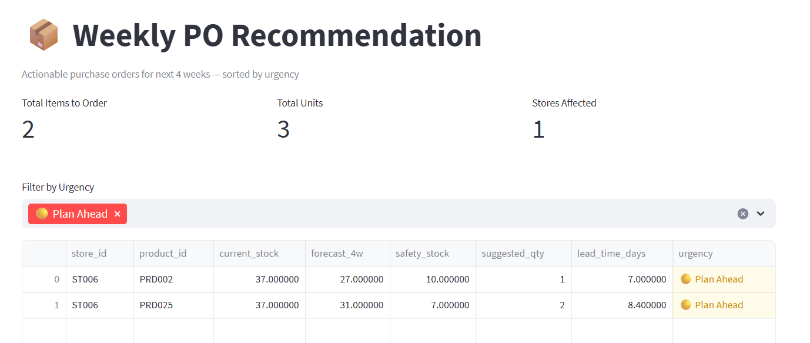
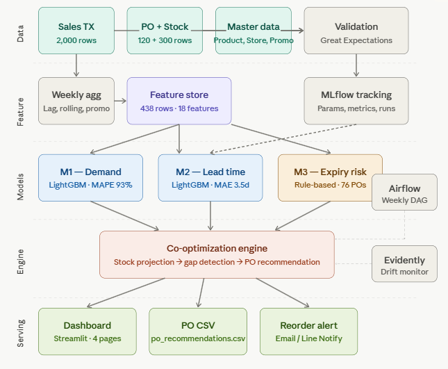

# 🛒 中小小売店のための売上最大化 DS ソリューション
 
> 需要予測・リードタイム予測・期限切れリスク検知を一つのパイプラインにまとめ、
> 「**何を・いくつ・いつ注文するか**」を提案するシステムです。
 
[🇹🇭 ภาษาไทย](README.md)
 
---
 
## 💡 ポイント：予測で終わらず「行動」まで提案する
 
```
需要予測（M1）
    ↓
4週間先の在庫を計算
    ↓
予測した需要 ＋ 安全在庫 と比べる
    ↓
出力：おすすめの発注（数量・タイミング・緊急度）
      ※ 仕入れ先ごとの実際のリードタイムで計算
```
 
| 一般的な予測 | このソリューション |
|---|---|
| 「来週は70箱売れる見込みです」 | 「水曜日までに30箱注文してください。リードタイムが3日で、金曜日にセールがあります」 |
| 出力は「情報」 | 出力は「判断」 |
| お店の人が自分で考える必要がある | 承認するだけで、すぐ実行できる |
 
---
 
## 📌 解決したい課題
 
| 課題 | 影響 | 解決方法 |
|---|---|---|
| 需要がわからず、注文数を間違える | 在庫過多・品切れ | 需要予測（M1） |
| 仕入れ先のリードタイムが安定しない | 発注のタイミングがずれる | リードタイム予測（M2） |
| 期限切れが近い商品に気づけない | 廃棄が増え、利益が減る | 期限切れリスク検知（M3） |
 
データを調べると、**注文（PO）の約3割（34件／120件）が、販売前に期限切れ**になっていました。
 
---
 
## 🔍 データ分析でわかったこと
 
- **土曜日の売上が最も高く、月曜日より約53%多い**（週末の影響が大きい）
- **乳製品と飲料で売上の約48%**を占める
- 割引は **10〜15%** が最も売上が高く、30%では逆に売上が下がる
- リードタイムは **3〜14日**（平均8.3日）とばらつきが大きい
---
 
## 🤖 モデルと結果
 
### M1：需要予測（LightGBM）
 
| 指標 | ベースライン | LightGBM | 改善 |
|---|---|---|---|
| MAPE（検証データ） | 116.68% | 93.09% | **約20%改善** |
| MAPE（テストデータ） | 105.97% | 101.56% | 約4%改善 |
 
> ※ 練習用のサンプルデータを使用しています。1回の販売数が少ない（1〜2個）ため、MAPE の値自体は高くなっています。
 
**LightGBM を選んだ理由**：セール・曜日・店舗タイプなど、時系列以外の特徴量も使えること、SHAP で「なぜその予測になったか」を説明できること、CPU で速く学習できることです。
 
**重要な特徴量（SHAP 上位）**：需要のばらつき（`rolling_std_8w`）、月末かどうか（`is_month_end`）、直近4週間の平均（`rolling_mean_4w`）
 
### M2：リードタイム予測
 
| 指標 | 結果 | 目標 |
|---|---|---|
| MAE（テスト） | 3.49日 | 1.5日未満 |
 
> データが120件と少ないため、現在は平均値（8.28日）を代わりに使っています。
 
### M3：期限切れリスク検知（ルールベース）
 
「売り切るまでの日数」と「期限までの日数」を比べて、リスクの高い注文を **76件** 見つけ、値下げ（10〜20%）を提案します。
 
---
 
## 📊 ダッシュボード（Streamlit・4ページ）
 
| ページ | 内容 |
|---|---|
| 📊 サマリー | 年間売上（約118万バーツ）、KPI、週ごとの売上、カテゴリ別の売上 |
| 📦 発注のおすすめ | 緊急度を色分けした表、CSV ダウンロード |
| 📈 需要予測 | 予測と実績の比較、曜日・月ごとのヒートマップ |
| ⚠️ 期限切れリスク | リスクの分布、対応が必要な注文の一覧 |
 

 

 
---
 
## ⚙️ MLOps パイプライン
 

 
1. **データ**：Great Expectations で品質チェック
2. **特徴量**：週単位に集計し、18個の特徴量を作成。MLflow で実験を管理
3. **モデル**：M1・M2・M3 を学習。モデルが35日以上古くなったら Airflow で再学習
4. **最適化エンジン**：3つのモデルの結果をまとめて発注を提案。Evidently AI でデータの変化を毎週監視
5. **出力**：ダッシュボード、CSV、緊急時のみ Email / LINE 通知
---
 
## 🛠️ 使用技術
 
| 分野 | ツール |
|---|---|
| データ処理 | Python, pandas, numpy |
| 機械学習 | LightGBM, scikit-learn |
| 説明可能性 | SHAP |
| 実験管理 | MLflow |
| ワークフロー | Airflow, Docker |
| ダッシュボード | Streamlit, Plotly |
 
---
 
## 🚀 実行方法
 
```bash
git clone https://github.com/Monspiritx/sme-retail-ds-solution
cd sme-retail-ds-solution
pip install -r requirements.txt
 
cd notebooks
streamlit run dashboard.py
```
 
ノートブックは `01 → 02 → 03 → 04` の順番で実行してください。
 
